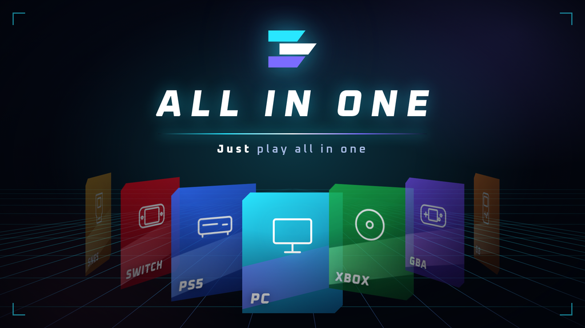
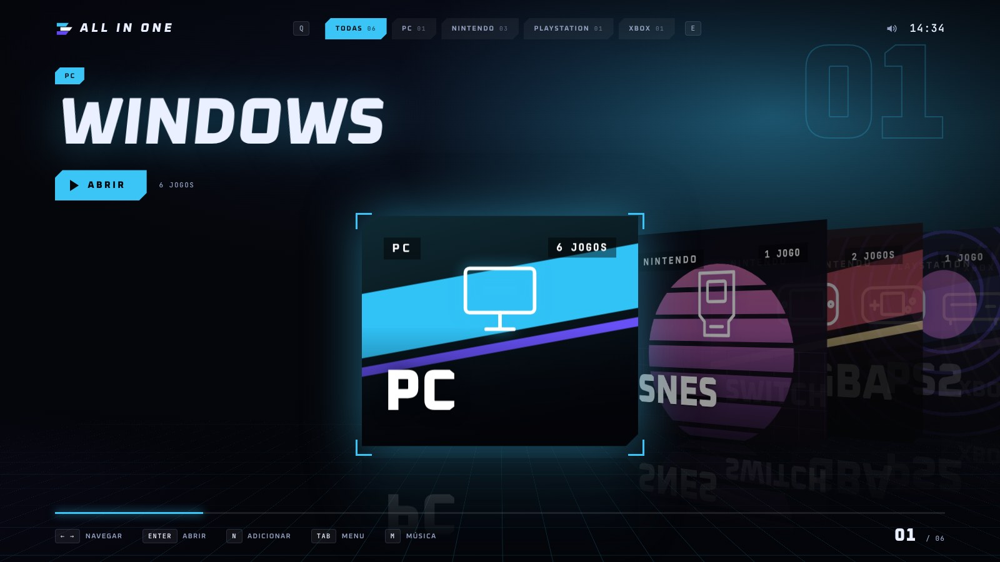
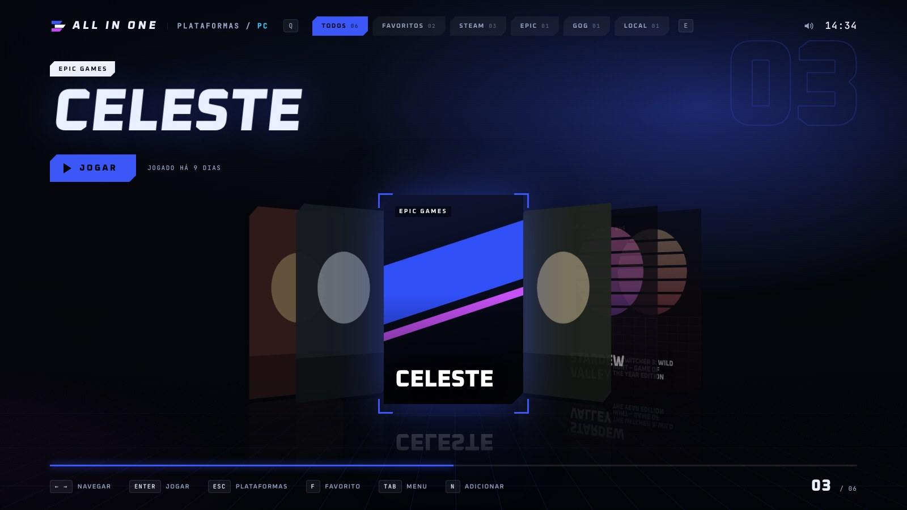

<p align="center">
  
</p>

<h1 align="center">All in One</h1>
<p align="center"><b>Just play all in one.</b><br>
Todos os seus jogos de PC e de console num só lugar, com cara de console e feito para controle.</p>

<p align="center">
  <a href="../../releases/latest"><b>⬇ Baixar para Windows</b></a>
</p>

> **English:** a console-style game hub for Windows. It gathers Steam, Epic, GOG and manually added games (including emulated consoles) in one controller-friendly carousel, with an on-screen keyboard and optional Discord Rich Presence. Download the ZIP from [Releases](../../releases/latest), extract it and run `All in One.exe`. The interface is in Portuguese (BR).

---

## O que é

O All in One reúne os seus jogos da **Steam**, **Epic Games** e **GOG** e também os que você adicionar à mão (qualquer `.exe`, inclusive emuladores) num único carrossel, organizado por **plataforma**: Windows, Switch, PlayStation, Xbox, SNES, GBA e muito mais.
Dá para usar tudo só com o controle do Xbox, sem encostar no teclado.

<p align="center">
  
  
</p>
<p align="center"><sub>Capturas com dados de exemplo.</sub></p>

## Destaques

- **Detecta sozinho** os jogos instalados na Steam, na Epic e na GOG.
- **Carrossel de plataformas** antes do de jogos: PC, Switch, PS1 a PS5, PSP, Vita, SNES, NES, N64, GameCube, Wii, GBA, DS, 3DS, Xbox, Xbox 360, Xbox One, Mega Drive, Dreamcast e outras.
- **Feito para controle:** navegação completa, teclado na tela para digitar nomes e caminhos, carrossel que dá a volta (do primeiro vai ao último).
- **Capas à sua maneira:** troque a capa de qualquer jogo, inclusive de jogos que a loja não tem imagem, ou arraste uma imagem para a janela.
- **Jogos de console:** adicione o emulador e a ROM, escolha a plataforma e jogue pelo mesmo menu.
- **Discord Rich Presence** opcional, com modo discreto que esconde o nome dos jogos.
- **Abertura e encerramento animados**, música e sons sintetizados pelo próprio programa (nenhum arquivo de áudio).
- **Sem conta, sem anúncios, sem telemetria.** Tudo fica no seu PC.

## Instalar

1. Baixe o `AllInOne-…-win-x64.zip` na página de [**Releases**](../../releases/latest) e extraia a pasta onde quiser.
2. Abra o **`All in One.exe`**. Não precisa instalar nada, nem ter Node.
3. **Aviso do Windows:** como o app não tem assinatura digital paga, o SmartScreen pode mostrar *"O Windows protegeu seu PC"*.
   Clique em **Mais informações → Executar assim mesmo**. O código-fonte está todo aqui no repositório para você conferir.

Requer Windows 10 ou 11 de 64 bits. Dica: clique com o direito no `.exe` e escolha "Fixar na barra de tarefas".

## Controles

| Teclado | Controle (Xbox) | Ação |
|---|---|---|
| ← → | direcional / analógico | navegar (do primeiro vai ao último e vice-versa) |
| Enter | A | abrir plataforma / jogar |
| Esc | B | voltar / fechar |
| F | X | favoritar |
| N | Y | adicionar jogo |
| Tab ou I | Start | menu de opções |
| Q / E | LB / RB | trocar filtro (ou grupo de consoles) |
| PgUp / PgDn | LT / RT | pular uma página |
| R | View | atualizar a biblioteca |
| M | | ligar/desligar a música |
| F11 | | tela cheia |
| Ctrl+Q ou fechar a janela | | sair (pede confirmação) |

Mouse também funciona: clique, roda e arrastar imagens.

## Adicionar jogos

Os jogos da Steam, Epic e GOG aparecem sozinhos. Para os outros, aperte **N** (ou **Y** no controle):

1. Escolha a **plataforma** (Windows, Switch, PS2…).
2. Escolha o **executável**. Atalhos `.lnk` e `.bat` também funcionam.
3. Dê um nome e, se quiser, argumentos e uma capa.

**Jogos de console:** o executável é o do **emulador** e os argumentos levam o caminho do jogo, por exemplo `-f "D:\Roms\jogo.iso"`. Cada emulador tem a sua sintaxe (veja a documentação dele).
O botão "Procurar" abre a janela do Windows, que o controle não opera; no controle, use o **teclado na tela**: **A** digita, **X** apaga, **Y** dá espaço, **LB/RB** movem o cursor, **View** alterna maiúsculas, **Start** confirma, **B** cancela.

> O All in One **não** inclui emuladores nem jogos. Use apenas jogos que você tem o direito de usar.

## Capas

Menu (Tab / Start) sobre o jogo → **Trocar capa** (ou **Adicionar capa**), ou **arraste uma imagem** PNG, JPG ou WEBP para a janela com o jogo selecionado.
A capa escolhida não é trocada pela busca automática. **Remover capa personalizada** volta ao normal.
As capas dos jogos da Steam são baixadas sozinhas. Epic e GOG ganham um pôster gerado a partir do nome, até você colocar uma capa.

## Ícones das plataformas

O app traz **desenhos próprios** para cada plataforma. Se quiser usar outras imagens (por exemplo, logos oficiais que você tenha):

1. No menu, abra **Ícones das plataformas**. Isso abre a pasta `%APPDATA%\AllInOne\platform-icons\`.
2. Coloque os arquivos (`.svg`, `.png`, `.webp`…) com o **id da plataforma** como nome: `switch.svg`, `ps2.png`, `x360.webp`…
3. O `LEIA-ME.txt` da pasta lista todos os ids. O app passa a usar os arquivos na hora.

## Discord Rich Presence

Com o Discord aberto no PC, seu perfil mostra o que você está fazendo:

- **Escolhendo plataforma:** "Escolhendo o próximo mundo", com a posição no carrossel.
- **Navegando:** "Explorando Nintendo Switch", "Olhando Hades".
- **Jogando:** "Jogando Hades", "PC · via Steam", com cronômetro.

No menu, **Discord Rich Presence** alterna entre **completo**, **discreto** (só a plataforma, sem nome de jogo) e **desligado**, e mostra se o Discord foi encontrado.
Se algo não aparecer, veja o arquivo `%APPDATA%\AllInOne\presence.log` e confira, no Discord, em *Configurações → Privacidade de Atividade*, se o compartilhamento de atividade está ligado.
Para usar o seu próprio aplicativo do Discord (com suas imagens), coloque o *Application ID* em `%APPDATA%\AllInOne\config.json`: `{ "discordAppId": "SEU_ID" }`.

## Privacidade

- Nada sai do seu PC, exceto: (1) o download das capas dos jogos da **Steam**, direto do servidor da Steam; (2) a conversa **local** com o app do Discord, se o Rich Presence estiver ligado.
- A biblioteca, os favoritos e as capas ficam em `%APPDATA%\AllInOne\`. Para zerar tudo, feche o app e apague essa pasta.

## Perguntas comuns

**Um jogo da Epic/GOG não apareceu.** Aperte **R** (View) para atualizar. A Epic só lista jogos instalados pelo Epic Games Launcher; na GOG, só os instalados pelo instalador oficial. Os que faltarem, adicione à mão.
**O controle não responde.** Clique na janela uma vez e mexa em um botão. O app usa o padrão Xbox (XInput); outros controles podem precisar do modo Xbox/XInput.
**Não vejo a plataforma X.** Plataformas sem jogos ficam ocultas. Menu → **Consoles sem jogos** mostra todas.
**Quero a música baixa ou desligada.** Menu → Música e Efeitos, separados.

## Para desenvolver

```
npm install
npm start            # tela cheia
npm run windowed     # em janela
npm run build        # gera dist\All in One-win32-x64\All in One.exe
npm test             # leitores de Steam/Epic/GOG, biblioteca e Rich Presence
```
(ou `iniciar.bat`, que faz o `npm install` na primeira vez e abre o app; `construir-exe.bat` gera o `.exe`)

Electron + HTML/CSS/JS puro, sem framework e sem dependências no Rich Presence.

```
main.js              janela, IPC, abrir jogos
preload.js           ponte segura entre a interface e o main
src/providers/       um módulo por loja: steam, epic, gog (scan() devolve a lista de jogos)
src/library.js       biblioteca em JSON: manuais, favoritos, ocultos, capas
src/discord.js       cliente do Discord Rich Presence (IPC local)
src/presence.js      o que mostrar no Discord + detecção de jogo aberto/fechado
src/covers.js        capas da Steam e cor do fundo
renderer/            interface: app.js, platforms.js, osk.js (teclado na tela), cinematic.js, audio.js, style.css
scripts/build.js     empacota o .exe
test/                testes
```

Para suportar outra loja, crie `src/providers/<loja>.js` com um `scan()` e registre em `src/providers/index.js`.
Histórico de versões no [CHANGELOG](CHANGELOG.md).

## Créditos e avisos

- Fontes **Oxanium** e **JetBrains Mono** (licença SIL OFL), incluídas em `renderer/fonts/`.
- Nintendo, Switch, PlayStation, Xbox, Steam, Epic Games, GOG, Discord e as demais marcas citadas pertencem aos seus donos.
  O All in One é um projeto independente e **não tem vínculo** com nenhuma dessas empresas.
